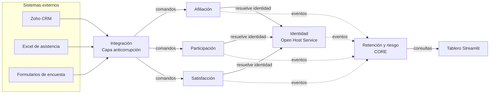
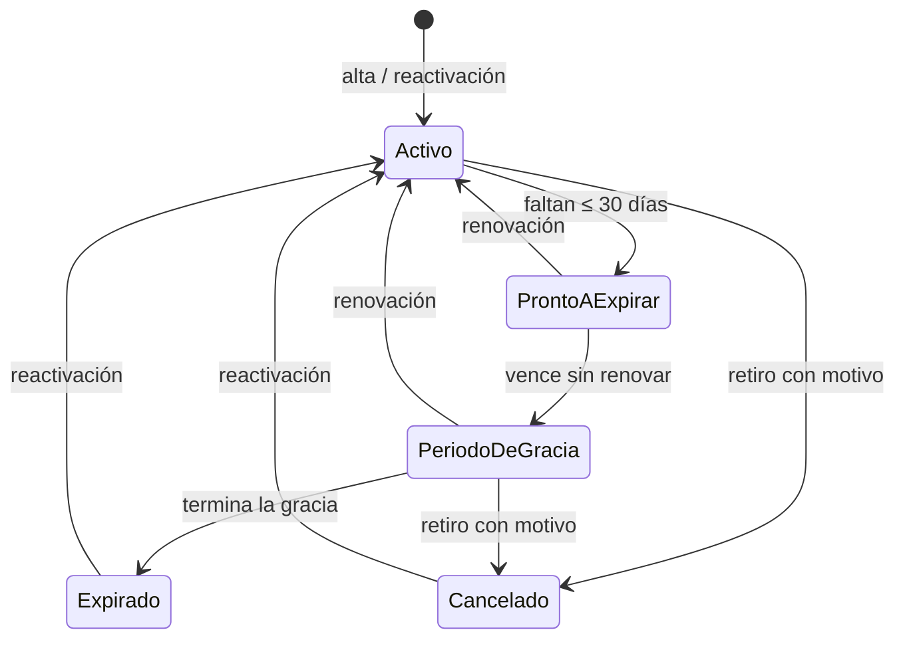
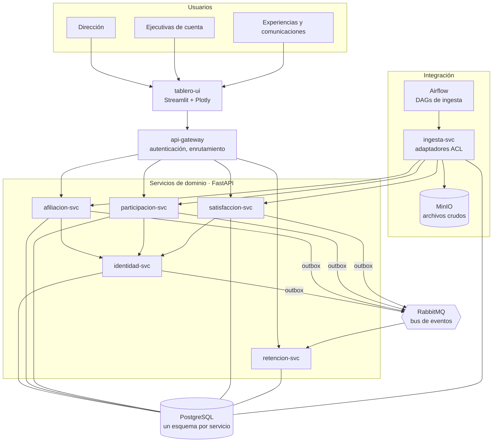
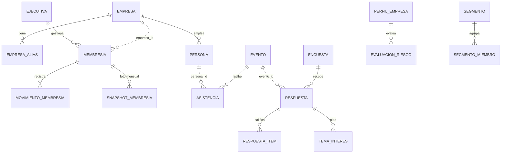
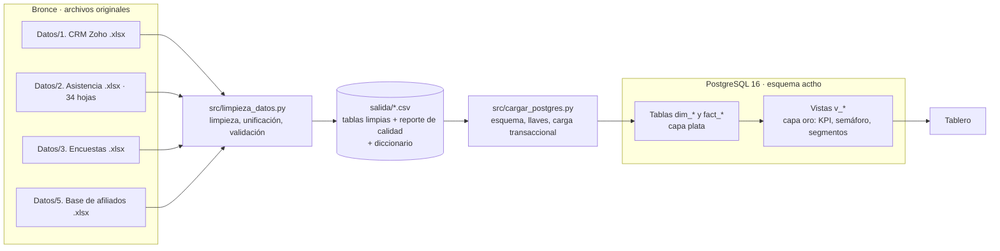
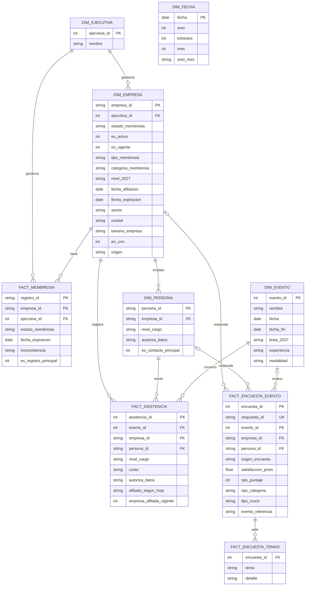
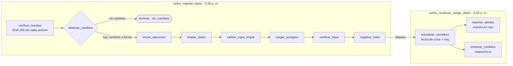
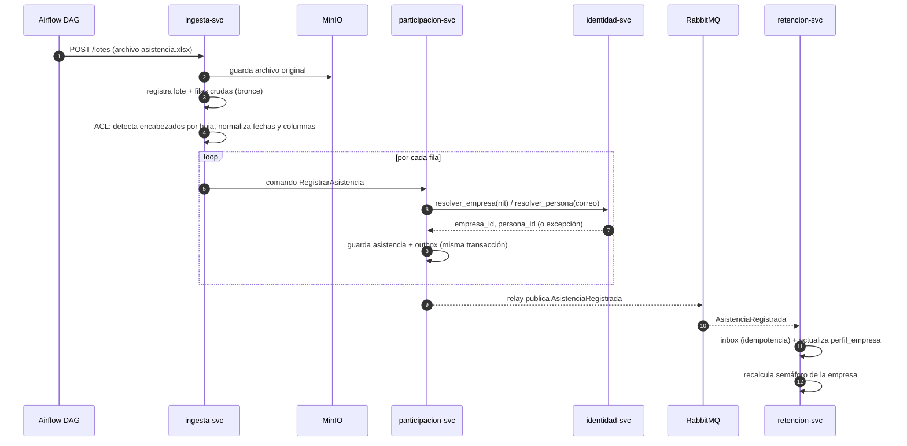

# ACTHO · Tablero Integral de Afiliados

Plataforma para saber **quién está afiliado a ACTHO, cómo participa, qué tan satisfecho está y a quién podemos perder**, a tiempo para actuar.

Integra tres fuentes que hoy no se conectan (Zoho CRM, Excel de asistencia y formularios de encuestas). Las procesa con reglas de negocio explícitas y le entrega a cada ejecutiva de cuenta su cartera priorizada con un semáforo de riesgo de no renovación.

> Proyecto del reto **Estud-IA** (Alcaldía de Medellín · ACTHO). Visualización 100 % en Python, sin Power BI.

---

## Tabla de contenido

1. [Problema que resolvemos](#1-problema-que-resolvemos)
2. [Principios de arquitectura](#2-principios-de-arquitectura)
3. [Diseño guiado por el dominio (DDD)](#3-diseño-guiado-por-el-dominio-ddd)
4. [Arquitectura de servicios](#4-arquitectura-de-servicios)
5. [Patrones arquitectónicos](#5-patrones-arquitectónicos)
6. [Modelo de datos en PostgreSQL](#6-modelo-de-datos-en-postgresql)
7. [Base de datos implementada (estado actual)](#7-base-de-datos-implementada-estado-actual)
8. [Eventos de dominio](#8-eventos-de-dominio)
9. [Flujos principales](#9-flujos-principales)
10. [Estructura del repositorio](#10-estructura-del-repositorio)
11. [Stack tecnológico](#11-stack-tecnológico)
12. [Escalabilidad](#12-escalabilidad)
13. [Seguridad y protección de datos](#13-seguridad-y-protección-de-datos)
14. [Cómo ejecutar](#14-cómo-ejecutar)
15. [Hoja de ruta paso a paso](#15-hoja-de-ruta-paso-a-paso)

---

## 1. Problema que resolvemos

| Situación actual | Efecto |
| --- | --- |
| 474 afiliados vigentes; **261 vencen en los próximos 60 días** (31 de diciembre de 2026) | Ola de renovación concentrada sin priorización |
| Solo **28 %** de los vigentes asistió a algún evento en los últimos 90 días | Afiliados que pagan pero no usan los beneficios |
| CRM, asistencia y encuestas sin identificador común confiable | Cruces manuales por nombre o correo, con errores |
| Fórmulas del consolidado de asistencia que no cubren todas las filas | ~1.200 asistencias reportadas frente a ~2.170 reales |
| Encuestas sin código de evento ni NIT | No se puede medir satisfacción por evento ni por empresa |

**Objetivo del sistema:** convertir estas fuentes en un modelo integrado y actualizable, con una sola definición por indicador, y en alertas accionables por ejecutiva.

---

## 2. Principios de arquitectura

1. **Dominio primero.** El código se organiza por capacidades del negocio (afiliación, participación, satisfacción, retención), no por capas técnicas.
2. **Servicios autónomos, no monolito.** Cada contexto de dominio es un servicio desplegable por separado, dueño de su esquema de datos. Ningún servicio lee las tablas de otro.
3. **Comunicación asíncrona por eventos.** Los servicios se enteran de los cambios de los demás por eventos de dominio, no por consultas directas a sus bases.
4. **Reglas explícitas y configurables.** Cada regla de negocio tiene un código (RN-ID-01, RN-RSG-01…) y sus parámetros viven en base de datos, no en el código.
5. **Las fuentes externas no contaminan el dominio.** Toda entrada pasa por una capa anticorrupción que traduce los formatos de Zoho, Excel y formularios al lenguaje del dominio.
6. **Trazabilidad.** Todo dato crudo se conserva tal como llegó (capa bronce) y cada transformación es repetible.

---

## 3. Diseño guiado por el dominio (DDD)

### 3.1 Subdominios

| Subdominio | Tipo | Por qué |
| --- | --- | --- |
| **Retención y riesgo** | Núcleo (*core*) | Es la ventaja del sistema: anticipar quién no va a renovar |
| **Afiliación** | Soporte | Ciclo de vida de la membresía; hoy vive en Zoho |
| **Participación** | Soporte | Eventos y asistencia |
| **Satisfacción** | Soporte | Encuestas, calificaciones y NPS |
| **Identidad** | Soporte | Resolver qué empresa y qué persona es cada registro |
| **Integración de fuentes** | Genérico | Leer archivos y APIs externas |

### 3.2 Contextos delimitados (*bounded contexts*) y lenguaje ubicuo

| Contexto | Agregados | Términos del lenguaje ubicuo |
| --- | --- | --- |
| **Identidad** | `Empresa`, `Persona` | NIT normalizado, dígito de verificación, alias, excepción de identidad, autorización de datos |
| **Afiliación** | `Membresia`, `Ejecutiva` | Vigente, Pronto a expirar, Periodo de gracia, Expirado, Cancelado, alta, renovación, retiro, reactivación, nivel (Conectar / Crecer / Liderar) |
| **Participación** | `Evento`, `Asistencia` | Línea 2027 (Anticipar, Foro, Pares, Evento grande), modalidad, tipo de asistente, activo en servicios |
| **Satisfacción** | `Encuesta`, `Respuesta` | Aspecto, promotor, pasivo, detractor, NPS, tema de interés |
| **Retención** | `EvaluacionRiesgo`, `Segmento` | Semáforo, puntaje, componente, fecha de corte, segmento de comunicación |
| **Integración** | `LoteCarga` | Fuente, lote, registro crudo, mapeo |

### 3.3 Mapa de contextos



**Relaciones:**

- **Integración → resto: capa anticorrupción (ACL).** Traduce columnas como `ID_EMPRESA (antes Nit)`, `Estado de la Membresía` o `14. De 0 a 10…` a comandos del dominio (`RegistrarAsistencia`, `ActualizarMembresia`, `RecibirRespuesta`).
- **Identidad → resto: *Open Host Service* + lenguaje publicado.** Expone una API estable `resolver_empresa(nit | correo | dominio | nombre)` y publica `EmpresaIdentificada`.
- **Afiliación, Participación, Satisfacción → Retención: cliente-proveedor por eventos.** Retención es cliente: consume eventos y construye su propio modelo de lectura.
- **Kernel compartido mínimo:** objetos de valor `EmpresaId`, `PersonaId`, `Nit`, `Correo` y la clase base de eventos (`libs/shared_kernel`).

### 3.4 Agregados e invariantes

| Agregado | Invariantes que protege |
| --- | --- |
| `Empresa` | Un NIT normalizado pertenece a una sola empresa; el dígito de verificación es válido (algoritmo DIAN) |
| `Persona` | Un correo normalizado pertenece a una sola persona; sin autorización de datos no entra a listas exportables |
| `Membresia` | Las transiciones de estado son válidas (ver máquina de estados); todo retiro tiene motivo de la lista cerrada; vigente implica fecha de expiración |
| `Evento` | Tiene línea 2027, modalidad y fecha de inicio |
| `Asistencia` | Una persona cuenta una sola vez por evento |
| `Respuesta` | Notas entre 1 y 5; NPS entre 0 y 10 |
| `EvaluacionRiesgo` | Puntaje entre 0 y 100; color derivado del puntaje con los umbrales vigentes; guarda la versión de reglas usada |

### 3.5 Máquina de estados de `Membresia`



---

## 4. Arquitectura de servicios



| Servicio | Responsabilidad | Escribe en | Publica | Consume |
| --- | --- | --- | --- | --- |
| `identidad-svc` | Normalizar NIT y correo, resolver alias, registrar excepciones | `identidad` | `EmpresaIdentificada`, `PersonaIdentificada`, `AutorizacionDatosCambiada` | — |
| `afiliacion-svc` | Ciclo de vida de la membresía, movimientos, foto mensual | `afiliacion` | `MembresiaActivada`, `MembresiaRenovada`, `MembresiaPorVencer`, `MembresiaVencida`, `MembresiaCancelada` | — |
| `participacion-svc` | Catálogo de eventos y asistencias | `participacion` | `AsistenciaRegistrada`, `EventoPublicado` | — |
| `satisfaccion-svc` | Respuestas, asignación de evento por fecha, NPS | `satisfaccion` | `RespuestaRecibida`, `DetractorDetectado`, `PromotorDetectado` | `AsistenciaRegistrada` (para desempatar el evento) |
| `retencion-svc` | Perfil 360 por empresa, semáforo, segmentos, indicadores | `retencion` | `RiesgoRecalculado`, `AlertaRiesgoGenerada` | Todos los anteriores |
| `ingesta-svc` | Leer fuentes, guardar crudo, traducir a comandos | `ingesta` + MinIO | `LoteCargado` | — |
| `api-gateway` | Autenticación (JWT), rutas, límites de uso | — | — | — |
| `tablero-ui` | Las 5 vistas, filtros y exportación | — (solo lectura vía API) | — | — |

---

## 5. Patrones arquitectónicos

| Patrón | Dónde | Para qué |
| --- | --- | --- |
| **Microservicios por contexto delimitado** | Todos los servicios | Desplegar, escalar y cambiar cada dominio por separado |
| **Arquitectura hexagonal (puertos y adaptadores)** | Dentro de cada servicio | El dominio no depende de FastAPI, SQLAlchemy ni RabbitMQ; se prueba sin infraestructura |
| **Capa anticorrupción (ACL)** | `ingesta-svc` | Aislar el dominio de los formatos de Zoho, Excel y formularios |
| **CQRS** | `retencion-svc` | Los servicios de dominio escriben; Retención mantiene modelos de lectura optimizados para el tablero |
| **Arquitectura orientada a eventos** | Bus RabbitMQ | Acoplamiento débil entre servicios |
| **Transactional Outbox** | Cada servicio que publica | Guardar el cambio y el evento en la misma transacción; un *relay* los publica después. Sin eventos perdidos ni duplicados por fallas |
| **Idempotent Consumer (Inbox)** | Cada consumidor | Procesar cada evento una sola vez aunque llegue repetido |
| **Repository + Unit of Work** | Capa de infraestructura | Persistir agregados sin filtrar SQL al dominio |
| **Strategy** | Cálculo de riesgo | Cada componente del semáforo (vencimiento, participación, amplitud, satisfacción) es una estrategia intercambiable con pesos configurables |
| **Specification** | Segmentos | Cada segmento es una especificación combinable (`NoParticipa & VenceEn(90)`) |
| **Chain of Responsibility** | Resolución de identidad | NIT → correo exacto → dominio → nombre normalizado, en orden de confianza (RN-ID-03) |
| **State** | `Membresia` | Transiciones válidas de estado encapsuladas en el agregado |
| **API Gateway / BFF** | `api-gateway` | Un solo punto de entrada para el tablero, con autenticación |
| **Arquitectura medallón** | `ingesta-svc` → servicios → `retencion-svc` | Bronce (crudo) → plata (limpio, en cada dominio) → oro (modelo de lectura) |
| **Database per service** | PostgreSQL | Un esquema y un usuario por servicio; se puede separar en bases físicas distintas sin cambiar código |

### 5.1 Capas dentro de cada servicio (hexagonal)

```
servicio/
├── domain/            # Entidades, agregados, objetos de valor, eventos, reglas. Python puro.
├── application/       # Casos de uso: comandos, consultas, manejadores. Define los puertos.
├── infrastructure/    # Adaptadores: repositorios SQLAlchemy, publicador RabbitMQ, clientes HTTP.
└── api/               # Adaptador de entrada: rutas FastAPI y esquemas Pydantic.
```

Regla de dependencia: `api → application → domain` y `infrastructure → application → domain`. **El dominio no importa nada de las otras capas.**

### 5.2 Ejemplo: semáforo de riesgo con Strategy

```python
# retencion/domain/riesgo.py
from dataclasses import dataclass
from typing import Protocol

@dataclass(frozen=True)
class PerfilEmpresa:
    dias_para_vencer: int | None
    en_periodo_gracia: bool
    eventos_ultimo_trimestre: int
    asistio_ultimos_12_meses: bool
    personas_distintas_12m: int
    es_detractor_reciente: bool
    nps_minimo_90d: int | None

class ComponenteRiesgo(Protocol):
    codigo: str
    def puntos(self, perfil: PerfilEmpresa, params: dict) -> int: ...

class Vencimiento:
    codigo = "vencimiento"
    def puntos(self, p, params):
        if p.en_periodo_gracia or (p.dias_para_vencer is not None and p.dias_para_vencer <= 30):
            return params["venc_30"]          # 35
        if p.dias_para_vencer is not None and p.dias_para_vencer <= 60:
            return params["venc_60"]          # 25
        if p.dias_para_vencer is not None and p.dias_para_vencer <= 90:
            return params["venc_90"]          # 15
        return 0

@dataclass(frozen=True)
class EvaluacionRiesgo:
    puntaje: int
    color: str
    componentes: dict[str, int]

class CalculadoraRiesgo:
    def __init__(self, componentes: list[ComponenteRiesgo], params: dict):
        self._componentes, self._params = componentes, params

    def evaluar(self, perfil: PerfilEmpresa) -> EvaluacionRiesgo:
        detalle = {c.codigo: c.puntos(perfil, self._params) for c in self._componentes}
        total = min(sum(detalle.values()), 100)
        color = ("Rojo" if total >= self._params["umbral_rojo"]
                 else "Amarillo" if total >= self._params["umbral_amarillo"]
                 else "Verde")
        return EvaluacionRiesgo(total, color, detalle)
```

Los parámetros (`venc_30`, `umbral_rojo`…) se leen de la tabla `retencion.parametro_regla`. Cambiarlos no requiere desplegar código.

---

## 6. Modelo de datos en PostgreSQL

> Esta sección describe la arquitectura **objetivo**. La base de datos que ya funciona está en la [sección 7](#7-base-de-datos-implementada-estado-actual).

### 6.1 Organización

- **Un clúster PostgreSQL 16** con **un esquema por servicio** y un rol de base de datos por servicio con permisos solo sobre su esquema.
- **Sin llaves foráneas entre esquemas.** Las referencias entre contextos son por identificador (`empresa_id`, `persona_id`) y se mantienen consistentes por eventos. Así, cualquier esquema puede moverse a otra base física cuando haga falta.
- **Identificadores UUID** (v7, ordenables por tiempo) como llave primaria; las llaves naturales (NIT, correo, código de evento) llevan restricción `UNIQUE`.
- **Tablas `outbox` e `inbox`** en cada esquema que publica o consume eventos.



> Líneas continuas: llave foránea dentro del mismo esquema. Líneas punteadas: referencia por identificador entre contextos (sin llave foránea).

### 6.2 DDL

```sql
-- =========================================================
-- Extensiones y esquemas
-- =========================================================
CREATE EXTENSION IF NOT EXISTS citext;
CREATE EXTENSION IF NOT EXISTS pgcrypto;

CREATE SCHEMA IF NOT EXISTS ingesta;
CREATE SCHEMA IF NOT EXISTS identidad;
CREATE SCHEMA IF NOT EXISTS afiliacion;
CREATE SCHEMA IF NOT EXISTS participacion;
CREATE SCHEMA IF NOT EXISTS satisfaccion;
CREATE SCHEMA IF NOT EXISTS retencion;

-- =========================================================
-- INGESTA (capa bronce): todo dato tal como llegó
-- =========================================================
CREATE TABLE ingesta.lote_carga (
    id              uuid PRIMARY KEY DEFAULT gen_random_uuid(),
    fuente          text NOT NULL CHECK (fuente IN ('zoho_crm','asistencia_excel','encuesta_presencial',
                                                    'encuesta_virtual','encuesta_post_evento','encuesta_90d')),
    archivo         text NOT NULL,
    hash_sha256     char(64) NOT NULL UNIQUE,          -- evita cargar dos veces el mismo archivo
    ruta_objeto     text NOT NULL,                     -- ubicación en MinIO
    filas           integer,
    estado          text NOT NULL DEFAULT 'recibido'
                    CHECK (estado IN ('recibido','procesando','procesado','con_errores')),
    cargado_en      timestamptz NOT NULL DEFAULT now()
);

CREATE TABLE ingesta.registro_crudo (
    lote_id         uuid NOT NULL REFERENCES ingesta.lote_carga(id),
    hoja            text,
    fila            integer NOT NULL,
    datos           jsonb NOT NULL,
    PRIMARY KEY (lote_id, hoja, fila)
);

-- =========================================================
-- IDENTIDAD
-- =========================================================
CREATE TABLE identidad.empresa (
    id              uuid PRIMARY KEY DEFAULT gen_random_uuid(),
    nit             varchar(15) UNIQUE,                -- solo dígitos, sin DV (RN-ID-01)
    digito_verif    char(1),
    codigo_anonimo  varchar(12) UNIQUE,                -- EMP-xxxx del paquete del reto
    razon_social    text,
    tipo_empresa    text,
    sector          text,
    subsector       text,
    tamano          text CHECK (tamano IN ('Micro','Pequeña','Mediana','Grande')),
    rango_empleados text,
    ciudad          text,
    departamento    text,
    creado_en       timestamptz NOT NULL DEFAULT now(),
    actualizado_en  timestamptz NOT NULL DEFAULT now()
);

CREATE TABLE identidad.empresa_alias (
    id              uuid PRIMARY KEY DEFAULT gen_random_uuid(),
    empresa_id      uuid NOT NULL REFERENCES identidad.empresa(id),
    tipo            text NOT NULL CHECK (tipo IN ('nit_variante','dominio_correo','nombre_normalizado')),
    valor           text NOT NULL,
    UNIQUE (tipo, valor)
);

CREATE TABLE identidad.persona (
    id                  uuid PRIMARY KEY DEFAULT gen_random_uuid(),
    correo              citext UNIQUE,                 -- llave natural (RN-ID-04)
    codigo_anonimo      varchar(12) UNIQUE,            -- P-xxxxx
    empresa_id          uuid REFERENCES identidad.empresa(id),
    nivel_cargo         text CHECK (nivel_cargo IN ('Alta dirección (C-level / VP)','Dirección / Gerencia',
                              'Jefatura / Coordinación','Profesional / Analista / Consultor',
                              'Estudiante / Practicante','Otro','Sin dato')),
    autoriza_datos      boolean NOT NULL DEFAULT false,
    fecha_autorizacion  timestamptz,
    creado_en           timestamptz NOT NULL DEFAULT now()
);

CREATE TABLE identidad.excepcion_identidad (
    id              uuid PRIMARY KEY DEFAULT gen_random_uuid(),
    lote_id         uuid NOT NULL,
    registro        jsonb NOT NULL,
    motivo          text NOT NULL,                     -- 'sin_nit_ni_correo', 'nombre_ambiguo', ...
    estado          text NOT NULL DEFAULT 'pendiente' CHECK (estado IN ('pendiente','resuelta','descartada')),
    resuelta_a      uuid,                              -- empresa_id asignada manualmente
    creado_en       timestamptz NOT NULL DEFAULT now()
);

-- =========================================================
-- AFILIACIÓN
-- =========================================================
CREATE TABLE afiliacion.ejecutiva (
    id              uuid PRIMARY KEY DEFAULT gen_random_uuid(),
    codigo          varchar(40) NOT NULL UNIQUE,       -- 'KAM A', ...
    nombre          text,
    correo          citext,
    activa          boolean NOT NULL DEFAULT true
);

CREATE TABLE afiliacion.homologacion_categoria (
    valor_origen        text PRIMARY KEY,              -- 'Estandar', 'Corporativa Estándar', ...
    categoria           text NOT NULL,                 -- 'Estándar' | 'Premium' | 'Elite' | ...
    nivel_2027          text CHECK (nivel_2027 IN ('Conectar','Crecer','Liderar'))
);

CREATE TABLE afiliacion.membresia (
    id                  uuid PRIMARY KEY DEFAULT gen_random_uuid(),
    empresa_id          uuid NOT NULL,                 -- ref. a identidad.empresa (sin FK)
    ejecutiva_id        uuid REFERENCES afiliacion.ejecutiva(id),
    tipo_membresia      text,
    categoria           text,
    nivel_2027          text,
    fecha_afiliacion    date,
    fecha_expiracion    date,
    estado              text NOT NULL CHECK (estado IN ('Activo','Pronto a Expirar','Periodo de Gracia',
                                                        'Expirado','Cancelado','Inactivo')),
    motivo_retiro       text CHECK (motivo_retiro IN ('Falta de beneficios percibidos','Falta de presupuesto',
                              'Cambio de intereses o prioridades','Conflictos internos',
                              'Falta de participación o comunidad','Problemas administrativos del cliente')),
    id_origen_crm       text UNIQUE,                   -- ID de registro en Zoho
    version             integer NOT NULL DEFAULT 1,    -- bloqueo optimista
    actualizado_en      timestamptz NOT NULL DEFAULT now(),
    CONSTRAINT vigente_con_fecha CHECK (
        estado NOT IN ('Activo','Pronto a Expirar','Periodo de Gracia') OR fecha_expiracion IS NOT NULL),
    CONSTRAINT retiro_con_motivo CHECK (estado <> 'Cancelado' OR motivo_retiro IS NOT NULL)
);
CREATE INDEX ix_membresia_empresa     ON afiliacion.membresia (empresa_id);
CREATE INDEX ix_membresia_vencimiento ON afiliacion.membresia (fecha_expiracion)
    WHERE estado IN ('Activo','Pronto a Expirar','Periodo de Gracia');

CREATE TABLE afiliacion.movimiento_membresia (
    id              uuid PRIMARY KEY DEFAULT gen_random_uuid(),
    membresia_id    uuid NOT NULL REFERENCES afiliacion.membresia(id),
    tipo            text NOT NULL CHECK (tipo IN ('alta','renovacion','retiro','reactivacion','cambio_categoria')),
    fecha           date NOT NULL,
    estado_anterior text,
    estado_nuevo    text NOT NULL,
    detalle         jsonb
);

-- Foto mensual: permite tasas de renovación, altas, retiros y tendencia (RN-MOV-05)
CREATE TABLE afiliacion.snapshot_membresia (
    periodo          date NOT NULL,                    -- primer día del mes
    membresia_id     uuid NOT NULL,
    empresa_id       uuid NOT NULL,
    ejecutiva_id     uuid,
    estado           text NOT NULL,
    categoria        text,
    nivel_2027       text,
    fecha_expiracion date,
    PRIMARY KEY (periodo, membresia_id)
) PARTITION BY RANGE (periodo);
CREATE TABLE afiliacion.snapshot_membresia_2026 PARTITION OF afiliacion.snapshot_membresia
    FOR VALUES FROM ('2026-01-01') TO ('2027-01-01');
CREATE TABLE afiliacion.snapshot_membresia_2027 PARTITION OF afiliacion.snapshot_membresia
    FOR VALUES FROM ('2027-01-01') TO ('2028-01-01');

-- =========================================================
-- PARTICIPACIÓN
-- =========================================================
CREATE TABLE participacion.evento (
    id              uuid PRIMARY KEY DEFAULT gen_random_uuid(),
    codigo          varchar(30) NOT NULL UNIQUE,       -- p. ej. 'EV-2026-01-05'
    nombre          text NOT NULL,
    linea_2027      text NOT NULL CHECK (linea_2027 IN ('Anticipar','Foro','Pares','Evento grande')),
    experiencia     text,
    modalidad       text NOT NULL CHECK (modalidad IN ('Presencial','Virtual','Híbrido')),
    fecha_inicio    date NOT NULL,
    fecha_fin       date,
    hoja_origen     text,
    CHECK (fecha_fin IS NULL OR fecha_fin >= fecha_inicio)
);

CREATE TABLE participacion.asistencia (
    id                  uuid PRIMARY KEY DEFAULT gen_random_uuid(),
    evento_id           uuid NOT NULL REFERENCES participacion.evento(id),
    persona_id          uuid NOT NULL,                 -- ref. a identidad.persona
    empresa_id          uuid,                          -- ref. a identidad.empresa
    tipo_asistente      text CHECK (tipo_asistente IN ('afiliado','no_afiliado')),
    con_costo           boolean,
    estado_registro     text NOT NULL DEFAULT 'asistio'
                        CHECK (estado_registro IN ('inscrito','agendado','asistio')),
    lote_id             uuid,
    registrado_en       timestamptz NOT NULL DEFAULT now(),
    UNIQUE (evento_id, persona_id)                     -- RN-PAR-01
);
CREATE INDEX ix_asistencia_empresa ON participacion.asistencia (empresa_id);

-- =========================================================
-- SATISFACCIÓN
-- =========================================================
CREATE TABLE satisfaccion.encuesta (
    id              uuid PRIMARY KEY DEFAULT gen_random_uuid(),
    codigo          varchar(40) NOT NULL UNIQUE,
    tipo            text NOT NULL CHECK (tipo IN ('presencial','virtual','post_evento','relacion_90d')),
    version         integer NOT NULL DEFAULT 1
);

CREATE TABLE satisfaccion.respuesta (
    id                       uuid PRIMARY KEY DEFAULT gen_random_uuid(),
    encuesta_id              uuid NOT NULL REFERENCES satisfaccion.encuesta(id),
    id_origen                text UNIQUE,              -- EP-0001, EV-0001, PE-0001
    persona_id               uuid,
    empresa_id               uuid,
    evento_id                uuid,                     -- asignado por RN-SAT-01
    completada_en            timestamptz NOT NULL,
    es_afiliado_declarado    boolean,
    interes_afiliarse        text,
    metodo_asig_empresa      text CHECK (metodo_asig_empresa IN ('nit','correo_exacto','dominio_correo',
                                         'nombre_empresa','sin_coincidencia','sin_datos')),
    metodo_asig_evento       text CHECK (metodo_asig_evento IN ('codigo','fecha_modalidad','fecha_asistencia','sin_evento'))
);
CREATE INDEX ix_respuesta_empresa_fecha ON satisfaccion.respuesta (empresa_id, completada_en);

CREATE TABLE satisfaccion.respuesta_item (
    respuesta_id    uuid NOT NULL REFERENCES satisfaccion.respuesta(id) ON DELETE CASCADE,
    aspecto         text NOT NULL CHECK (aspecto IN ('logistica','convocatoria','conferencistas','relevancia',
                                                     'satisfaccion_general','nps','intencion_renovar')),
    valor           smallint NOT NULL,
    PRIMARY KEY (respuesta_id, aspecto),
    CHECK ((aspecto IN ('nps','intencion_renovar') AND valor BETWEEN 0 AND 10)
        OR (aspecto NOT IN ('nps','intencion_renovar') AND valor BETWEEN 1 AND 5))
);

CREATE TABLE satisfaccion.tema_interes (
    respuesta_id    uuid NOT NULL REFERENCES satisfaccion.respuesta(id) ON DELETE CASCADE,
    tema            text NOT NULL,
    PRIMARY KEY (respuesta_id, tema)
);

-- =========================================================
-- RETENCIÓN (modelo de lectura / capa oro · CQRS)
-- =========================================================
CREATE TABLE retencion.parametro_regla (
    codigo          varchar(40) NOT NULL,              -- 'venc_30', 'umbral_rojo', ...
    valor           numeric NOT NULL,
    descripcion     text,
    vigente_desde   date NOT NULL DEFAULT current_date,
    PRIMARY KEY (codigo, vigente_desde)
);

-- Proyección alimentada por eventos de los demás contextos
CREATE TABLE retencion.perfil_empresa (
    empresa_id              uuid PRIMARY KEY,
    nombre                  text,
    ejecutiva_codigo        text,
    categoria               text,
    nivel_2027              text,
    sector                  text,
    ciudad                  text,
    estado_membresia        text,
    fecha_expiracion        date,
    ultima_asistencia       date,
    eventos_ultimo_trimestre integer NOT NULL DEFAULT 0,
    personas_distintas_12m  integer NOT NULL DEFAULT 0,
    peor_nota_90d           smallint,
    nps_minimo_90d          smallint,
    actualizado_en          timestamptz NOT NULL DEFAULT now()
);

CREATE TABLE retencion.evaluacion_riesgo (
    id              uuid PRIMARY KEY DEFAULT gen_random_uuid(),
    empresa_id      uuid NOT NULL REFERENCES retencion.perfil_empresa(empresa_id),
    fecha_corte     date NOT NULL,
    puntaje         smallint NOT NULL CHECK (puntaje BETWEEN 0 AND 100),
    color           text NOT NULL CHECK (color IN ('Rojo','Amarillo','Verde')),
    componentes     jsonb NOT NULL,                    -- {"vencimiento":25,"participacion":25,...}
    motivo          text NOT NULL,                     -- texto legible para la ejecutiva
    version_reglas  varchar(20) NOT NULL,
    UNIQUE (empresa_id, fecha_corte)
);
CREATE INDEX ix_eval_corte_color ON retencion.evaluacion_riesgo (fecha_corte, color);

CREATE TABLE retencion.segmento (
    codigo          varchar(40) PRIMARY KEY,           -- 'no_participa', 'vence_90', 'detractor', ...
    nombre          text NOT NULL,
    especificacion  jsonb NOT NULL                     -- composición de Specifications
);

CREATE TABLE retencion.segmento_miembro (
    id              uuid PRIMARY KEY DEFAULT gen_random_uuid(),
    segmento_codigo varchar(40) NOT NULL REFERENCES retencion.segmento(codigo),
    fecha_corte     date NOT NULL,
    empresa_id      uuid NOT NULL,
    persona_id      uuid,                              -- nulo cuando el segmento es por empresa
    UNIQUE NULLS NOT DISTINCT (segmento_codigo, fecha_corte, empresa_id, persona_id)
);

-- Vista de consulta para "Mi cartera"
CREATE VIEW retencion.v_mi_cartera AS
SELECT p.ejecutiva_codigo, p.empresa_id, p.nombre, p.categoria, p.fecha_expiracion,
       (p.fecha_expiracion - current_date) AS dias_para_vencer,
       p.ultima_asistencia, p.eventos_ultimo_trimestre, p.personas_distintas_12m,
       e.puntaje, e.color, e.motivo
FROM retencion.perfil_empresa p
JOIN LATERAL (
    SELECT * FROM retencion.evaluacion_riesgo r
    WHERE r.empresa_id = p.empresa_id
    ORDER BY r.fecha_corte DESC LIMIT 1
) e ON true
WHERE p.estado_membresia IN ('Activo','Pronto a Expirar','Periodo de Gracia');

-- =========================================================
-- OUTBOX / INBOX (se repite en cada esquema que publica o consume)
-- =========================================================
CREATE TABLE afiliacion.outbox (
    id              uuid PRIMARY KEY DEFAULT gen_random_uuid(),
    tipo_agregado   text NOT NULL,
    agregado_id     uuid NOT NULL,
    tipo_evento     text NOT NULL,
    payload         jsonb NOT NULL,
    ocurrido_en     timestamptz NOT NULL DEFAULT now(),
    publicado_en    timestamptz
);
CREATE INDEX ix_outbox_pendiente ON afiliacion.outbox (ocurrido_en) WHERE publicado_en IS NULL;

CREATE TABLE retencion.inbox (
    evento_id       uuid PRIMARY KEY,                  -- garantiza procesamiento idempotente
    tipo_evento     text NOT NULL,
    procesado_en    timestamptz NOT NULL DEFAULT now()
);
```

### 6.3 Roles y permisos

```sql
CREATE ROLE afiliacion_svc LOGIN PASSWORD :'pwd_afiliacion';
GRANT USAGE, CREATE ON SCHEMA afiliacion TO afiliacion_svc;
REVOKE ALL ON SCHEMA identidad, participacion, satisfaccion, retencion FROM afiliacion_svc;
-- Se repite para cada servicio. El tablero usa un rol de solo lectura sobre retencion.
CREATE ROLE tablero_ro LOGIN PASSWORD :'pwd_tablero';
GRANT USAGE ON SCHEMA retencion TO tablero_ro;
GRANT SELECT ON ALL TABLES IN SCHEMA retencion TO tablero_ro;
```

---

## 7. Base de datos implementada (estado actual)

La sección 6 describe la arquitectura **objetivo** (un esquema por servicio). Hoy el proyecto ya tiene una **primera versión funcional** de la base de datos: un solo esquema `actho` en PostgreSQL 16 con un modelo en estrella. Lo genera un *pipeline* en Python reproducible y alimenta directamente el tablero.

### 7.1 Flujo de datos



Todo se ejecuta con un solo comando (`python setup.py`, ver 7.8). Cada corrida **recrea el esquema completo** dentro de una transacción: si algo falla no queda nada a medias, y repetirla no duplica datos.

### 7.2 Modelo entidad-relación



Tablas de apoyo sin relaciones: `reporte_calidad` (hallazgos de la limpieza), `diccionario_datos` (definición de cada campo) y `config_parametro` (fecha de corte y umbrales del semáforo).

### 7.3 Tablas

| Tabla | Grano (una fila por…) | Filas* | Llave primaria | Llaves foráneas |
| --- | --- | ---: | --- | --- |
| `dim_empresa` | empresa (CRM + empresas que participan sin estar en el CRM) | 1.848 | `empresa_id` | `ejecutiva_id` |
| `dim_persona` | persona | 3.263 | `persona_id` | `empresa_id` |
| `dim_evento` | evento 2026 (hoja de homologación) | 34 | `evento_id` | — |
| `dim_ejecutiva` | ejecutiva de cuenta | 10 | `ejecutiva_id` | — |
| `dim_fecha` | día (2025-2027) | 1.095 | `fecha` | — |
| `fact_membresia` | registro del CRM (una empresa puede tener varios) | 1.071 | `registro_id` | `empresa_id`, `ejecutiva_id` |
| `fact_asistencia` | persona inscrita en un evento | 3.304 | `asistencia_id` | `evento_id`, `empresa_id`, `persona_id` |
| `fact_encuesta_evento` | respuesta de encuesta (presencial, virtual, post-evento) | 778 | `encuesta_id` (+ `respuesta_id` único) | `evento_id`, `empresa_id`, `persona_id` |
| `fact_encuesta_temas` | tema pedido en una respuesta | 96 | — | `encuesta_id` |
| `dim_servicio` | servicio de la oferta 2027 (catálogo del documento de equivalencias) | 18 | `servicio_id` | — |
| `fact_uso_beneficio` | uso de un beneficio (asistencia, comunidad vigente, encuesta de 90 días o plantilla mensual) | 3.919 | `uso_id` | `empresa_id`, `servicio_id` |
| `fact_encuesta_relacion` | respuesta de la encuesta de relación a 90 días (NPS de ACTHO) | 0 (lista para recibir) | `respuesta_id` | `empresa_id` |
| `reporte_calidad` | hallazgo de calidad | 66 | — | — |
| `diccionario_datos` | campo de una tabla | 180 | — | — |

\* Con los archivos del reto y fecha de corte 23/11/2026.

**Decisiones del modelo:**

- **Llave común:** el código anonimizado de empresa (`EMP-####`) y de persona (`P-#####`). Es el mismo en CRM, asistencia y encuestas, así que reemplaza el NIT del paquete original.
- **`dim_empresa` incluye a los no afiliados** (`en_crm = 0`, 798 empresas). Son las que aparecen en asistencia o encuestas sin registro en el CRM y permiten medir los *asistentes no afiliados*.
- **Una empresa, un registro principal.** Cuando el CRM tiene varios registros de la misma empresa, `dim_empresa` toma el vigente o el más reciente. Todos los registros quedan en `fact_membresia`.
- **Las encuestas pueden no tener empresa ni evento.** `empresa_id` y `evento_id` aceptan nulos. `tipo_cruce` indica qué tan confiable es la empresa asignada (Exacto, Aproximado, Sin coincidencia, Sin empresa). `evento_inferencia` dice si el evento se asignó por fecha.
- **Integridad garantizada por la base:** 12 llaves primarias, 14 llaves foráneas y 1 restricción `UNIQUE`. Si una fila no cumple, la carga se revierte completa.
- **Autodocumentada:** cada columna lleva su descripción del diccionario como comentario (`COMMENT ON COLUMN`), visible en DBeaver o pgAdmin.
- **Índices** en las columnas que más se filtran: `empresa_id`, `evento_id`, `persona_id`, `estado_membresia` y `ejecutiva_id`.

### 7.4 Vistas para el tablero (capa oro)

Todas están definidas en `sql/vistas_dashboard.sql` y usan la fecha de corte y los umbrales de `config_parametro`.

| Vista | Uso en el tablero |
| --- | --- |
| `v_kpi_principal` | Tarjetas del panel en una fila: activos, vigentes, nuevos, vencimientos a 30/60/90 días, tasa de renovación, % que participa, semáforo, no afiliados, satisfacción y NPS |
| `v_empresa_360` | Tabla principal: una fila por empresa con filtros, participación, satisfacción, puntaje, semáforo y motivos legibles |
| `v_vencimientos_proximos` | Vencimientos a 90 días y vencidas sin renovar, ordenados por riesgo |
| `v_cartera_ejecutiva` | Vista "Mi cartera": resumen por ejecutiva |
| `v_tasa_renovacion` | Renovados, no renovados y tasa aproximada (ver 7.6) |
| `v_movimiento_mensual` | Altas, vencimientos y retiros por mes |
| `v_afiliados_distribucion` | Vigentes por nivel, tipo, sector, tamaño, ciudad y ejecutiva |
| `v_participacion_mensual` | Inscripciones, personas, empresas y eventos por mes, línea, modalidad y condición (afiliada o no) |
| `v_participacion_nivel_cargo` | Participación por nivel de cargo |
| `v_evento_resumen` | Por evento: inscritos, empresas, % afiliados, satisfacción y NPS |
| `v_satisfaccion_mensual` | Satisfacción, calificaciones por aspecto y NPS por mes |
| `v_temas_solicitados` | Temas pedidos para próximos espacios |
| `v_relacion_participacion_renovacion` | Vista integrada: % vigentes y satisfacción según nivel de participación |
| `v_no_afiliados_potenciales` | Empresas que participan sin membresía vigente |
| `v_uso_beneficio_detalle` / `v_empresa_beneficios` | Uso de beneficios fila a fila y por empresa (usos en la ventana y en 12 meses, servicios, fuentes) |
| `v_empresa_aprovechamiento` | Servicios incluidos en el nivel 2027 que ya se pueden medir y cuántos usó cada empresa |
| `v_nps_actho` / `v_encuesta_relacion_detalle` | NPS de ACTHO, intención de renovar, bienvenida y ejecutiva (encuesta de 90 días, sin pruebas) |
| `v_encuesta_90d_por_enviar` | Afiliados que cumplen 90 días o a los que les faltan ~60 para renovar, sin respuesta reciente |
| `definicion_indicador` (tabla) | Definición, cálculo, fuente y estado (Propuesta / Acordada) de cada indicador; alimenta los íconos de ayuda |
| `v_conciliacion_activos` / `v_conciliacion_detalle` | Por qué Zoho cuenta 481 «Activo» y el tablero 433 activos / 474 vigentes |
| `historial.v_renovacion_medida` | Renovó / No renovó / Pendiente por empresa, comparando fotos mensuales consecutivas |
| `v_segmentos_comunicacion` / `v_segmentos_resumen` | Los 7 segmentos de comunicaciones del reto, con la columna `autoriza_datos` para exportar solo personas autorizadas |
| `v_asistencia_detalle` / `v_encuesta_detalle` | Detalle fila a fila con los atributos de empresa y evento |
| `v_empresa_actividad` / `v_empresa_satisfaccion` | Métricas intermedias por empresa |
| `v_calidad_resumen` | Página de calidad de datos |
| `v_parametros` | Parámetros vigentes en una fila |

Ejemplo, la cartera en riesgo de una ejecutiva:

```sql
SELECT empresa_id, nivel_2027, dias_a_vencer, ultima_asistencia,
       satisfaccion_promedio, puntaje_riesgo, semaforo, motivos_riesgo
FROM actho.v_empresa_360
WHERE ejecutiva = 'KAM B' AND semaforo IN ('Rojo', 'Amarillo')
ORDER BY puntaje_riesgo DESC, dias_a_vencer;
```

### 7.5 Semáforo de riesgo implementado

Solo se evalúan las membresías vigentes (Activo, Pronto a expirar, Periodo de gracia). El puntaje suma tres componentes:

| Componente | Condición | Puntos |
| --- | --- | ---: |
| Vencimiento | Vencida o en periodo de gracia | 3 |
| | Vence en 0-30 días | 3 |
| | Vence en 31-60 días | 2 |
| | Vence en 61-90 días | 1 |
| Participación | Sin **uso de beneficios** en los últimos 90 días (asistencia, encuesta de 90 días o plantilla mensual) | 2 |
| | … y tampoco en los últimos 12 meses (aquí también cuenta estar vinculado a una comunidad) | +1 |
| Satisfacción | Detractor reciente (NPS 0-6 o nota ≤ 3 en los últimos 180 días) | 3 |
| | Satisfacción promedio menor a 4,0 (últimos 12 meses) | 2 |

**Rojo** (riesgo alto) con 5 puntos o más, **Amarillo** (medio) con 3 o 4, **Verde** (bajo) con menos de 3. La participación mide el **uso de beneficios**, no solo la asistencia: la oferta 2027 promete valor aunque el afiliado no asista. Las ventanas, los puntos y los umbrales están en `actho.config_parametro`. Cada empresa trae el texto `motivos_riesgo`, por ejemplo: *"Membresía vencida · Sin participación en 12 meses"*.

> Diferencia con la sección 5.2: la versión objetivo usa una escala de 0 a 100 y un componente adicional de amplitud (personas distintas). La versión actual usa una escala corta (0 a 9) y tres componentes, porque es más fácil de explicar y validar con ACTHO. El cambio de escala solo implica ajustar los parámetros.

### 7.6 Resultados con los datos del reto (corte 23/11/2026)

| Indicador | Valor |
| --- | ---: |
| Afiliados activos / vigentes | 433 / 474 |
| Vencen en los próximos 60 días (259 el 31/12/2026) | 261 |
| Vigentes vencidas sin renovar (periodo de gracia) | 41 |
| Vigentes que usaron algún beneficio en los últimos 90 días | 27,8 % |
| Vigentes con algún uso en 12 meses (incluye comunidades) | 422 |
| Aprovechamiento promedio del nivel | 33 % |
| Semáforo alto / medio / bajo | 61 / 197 / 216 |
| Tasa de renovación (aproximada) | 74,6 % |
| Empresas / personas que asisten sin estar afiliadas | 825 / 1.172 |
| Satisfacción promedio (1-5) | 4,79 |
| NPS de eventos (41 respuestas) | 85 |

**Límites conocidos:**

- **Tasa de renovación aproximada.** Zoho sobrescribe la fecha de expiración al renovar y no guarda historial. Se cuentan como renovados los vigentes con más de un año de afiliación, y como no renovados los cancelados o expirados cuya expiración cayó en los últimos 12 meses. Desde ahora el DAG diario guarda una foto mensual (`historial.snapshot_membresia`), y `historial.v_movimientos_mensuales` mide las renovaciones reales a partir del segundo mes.
- **NPS de eventos con pocas respuestas** (41). El NPS de ACTHO (encuesta de 90 días) queda conectado pero vacío: el archivo del reto trae el instrumento sin respuestas. La carga se probó con respuestas de ensayo.
- **Uso de beneficios digitales:** boletín, GetAbstract, Presencia, podcast, Sello y Centro de Experiencias no dejan registro. Se suman con la plantilla mensual (`Datos/8. Uso de beneficios/uso_beneficios.xlsx`, descargable en Datos y calidad) y con la pregunta 3.1 de la encuesta de 90 días.
- **Conciliación con Zoho:** los 481 registros «Activo» de Zoho son 432 activos, 33 en periodo de gracia, 8 pronto a expirar y **8 con la membresía expirada** (error de captura a corregir en el CRM).
- **Detractores:** hoy no hay ninguno en los datos (la nota más baja es 8 en NPS y 3,25 en satisfacción), así que ese segmento aparece vacío.
- **Evento de cada encuesta:** se infiere por fecha y modalidad. Se asignaron 304 de 778 respuestas. Las de 2025 no corresponden a eventos de 2026 y algunas fechas tienen dos eventos.
- **`afiliado_segun_hoja`:** la primera columna de las hojas de asistencia usa los códigos 1 y 2. Los datos sugieren 1 = afiliado y 2 = no afiliado (90 % frente a 14 % de empresas vigentes), pero falta confirmarlo con ACTHO.

### 7.7 Limpieza y calidad de datos

`src/limpieza_datos.py` resuelve las dificultades del documento *Gestión de la información* y registra cada corrección en `reporte_calidad` (tabla, campo, problema, regla, filas afectadas, acción):

| Problema | Regla |
| --- | --- |
| Tildes dañadas (`Bogotﾃ｡`) y variantes (`Bogota`, `BOGOTA`, `Estandar`, `Tecnologia`) | Se repara la codificación y se unifica por clave sin tildes |
| Tipo y categoría de membresía mezclados (`Corporativa Estándar`, `Personal Premium`, `Empresas`) | Se separan en tipo y categoría, y se mapea el nivel 2027 |
| Registros de prueba | Se excluyen (`salida/excluidos_crm.csv`) |
| Empresas repetidas en el CRM | Se consolidan en un registro principal |
| 34 hojas de asistencia con encabezados distintos y una hoja vacía | Detección de encabezados por hoja; se cuenta cada inscrito y no la hoja GENERAL |
| Persona repetida en un mismo evento | Se deja una sola inscripción |
| Fechas en texto (`mar. 27, 2025 09:24 a. m.`) e imposibles (2066) | Se interpretan; las imposibles se anulan y se marcan |
| Autorización de datos escrita de 9 formas | Se unifica en Sí / No / Sin dato; ante contradicción prevalece No |
| NPS como texto (`10 (Promoter)`) y notas fuera de rango | Se convierten a número; las fuera de rango se anulan |
| Categorías vacías | `Sin dato` (las fechas y números vacíos no se inventan) |
| Valores extremos | Se marcan por rango intercuartílico, no se eliminan |
| Incoherencias (Activo con expiración vencida, vigente sin fecha) | Se marcan en `inconsistencia` para revisión |

### 7.8 Cómo ejecutar la versión actual

Requisito: Python 3.9 o superior. No hace falta instalar PostgreSQL ni Docker: si no hay ninguno, `setup.py` lo instala sin preguntar.

```bash
# 1. Copiar el paquete del reto en la carpeta Datos/ (no se sube a GitHub)
# 2. Un solo comando:
python3 setup.py              # Windows: py setup.py
```

`setup.py` deja todo funcionando y abre el tablero en Google Chrome. Si un paso ya está hecho, lo salta (aparece `SALTO` en la consola):

1. Verifica Python y crea el entorno virtual fuera del proyecto (ver el punto 4; si ya existe y funciona, lo salta). La carpeta `.venv` de versiones anteriores ya no se usa y se puede borrar.
2. Instala `requirements.txt` (solo si cambió desde la última instalación).
3. Configura VS Code y verifica la carpeta `Datos/`.
4. Busca PostgreSQL en este orden: la URL de `.env`, luego `docker compose up -d postgres` y luego un PostgreSQL instalado en el equipo (Homebrew, Postgres.app, `apt`), con el que crea una base propia (puerto 5433 o el siguiente libre, solo `localhost`). Si no encuentra ninguno, instala PostgreSQL 16 portátil (descarga única de unos 30 MB del paquete `pgserver` de PyPI, sin permisos de administrador). Si eso también falla y Docker Desktop está instalado pero cerrado, lo abre y lo usa. Guarda la conexión en `.env`.
   - **Dónde quedan el entorno de Python y PostgreSQL:** fuera del proyecto, en `~/Library/Application Support/ACTHO` (macOS), `%LOCALAPPDATA%\ACTHO` (Windows) o `~/.local/share/actho` (Linux); se puede cambiar con la variable `ACTHO_DATOS`. Si el proyecto está en una carpeta sincronizada (iCloud Documentos con «Optimizar almacenamiento», OneDrive, Dropbox), sus miles de archivos se suben a la nube y se descargan al usarlos: en un Mac así, la base tardó más de 20 minutos en arrancar y los modelos 18 minutos en entrenar (13 segundos fuera de iCloud). Los `.pyc` también se guardan allá (`PYTHONPYCACHEPREFIX`). Si una versión anterior dejó `.pgdata/` o `.postgres/` dentro del proyecto, `setup.py` los mueve allá automáticamente sin perder el historial.
   - Si el servidor tarda en arrancar, espera mostrando el avance; si falla, muestra las últimas líneas del registro del servidor.
5. Limpia y carga los datos solo si alguna fuente cambió (huella SHA-256). Siempre recalcula el semáforo. Si cambiaron los datos o la fecha de corte, entrena los modelos de IA (sección 7.11) **en segundo plano** mientras el tablero ya está abierto (registro en `modelos_ia.log` de la misma carpeta); las secciones de IA aparecen al terminar. Con `--sin-tablero` los entrena antes de salir.
6. Inicia Streamlit en `http://localhost:8501` (o el siguiente puerto libre), solo en `localhost`, espera hasta 4 minutos mostrando el avance y abre Chrome. `Ctrl+C` lo detiene. Todo lo que sale en la consola queda también en `setup.log`.

Opciones: `--solo-instalar`, `--reinstalar`, `--forzar` (reprocesa aunque no haya cambios), `--fecha-corte AAAA-MM-DD`, `--sin-tablero`, `--sin-navegador` y `--puerto N`. `-y` se acepta por compatibilidad (ya no hay preguntas).

Usuario inicial del tablero: **admin** / **actho**. Hay que cambiarlo antes de compartir el tablero (ver 7.10).

| Archivo | Función |
| --- | --- |
| `setup.py` | Prepara el entorno y ejecuta los pasos en orden |
| `src/limpieza_datos.py` | Limpieza, unificación, reporte de calidad y diccionario (`salida/`) |
| `src/cargar_postgres.py` | Crea el esquema, carga las tablas y ejecuta las vistas |
| `sql/esquema.sql` | DDL generado (tablas, llaves, comentarios, índices) |
| `sql/vistas_dashboard.sql` | Parámetros y vistas del tablero |
| `docker-compose.yml`, `.env.ejemplo` | PostgreSQL y Airflow locales, y plantilla de conexión |
| `src/ingesta_control.py` | Huellas, detección de cambios, validación, verificación, recálculo, historial y entrenamiento de modelos |
| `src/modelos_ia.py`, `src/simulador_eventos.py` | Modelos de apoyo de IA (esquema `ia`) y simulador de eventos (ver 7.11) |
| `src/recursos/` | Validación manual de temas (`temas_validacion.csv`) y correcciones de tema por evento (`temas_eventos.csv`) |
| `sql/control.sql` | Esquemas persistentes `ingesta` e `historial` |
| `pipelines/airflow/dags/` | DAG `actho_ingesta_datos` y `actho_recalculo_riesgo_diario` (ver 7.9) |
| `frontend/tablero/` | Tablero Streamlit: `Inicio.py` (navegación), `login.py` y `auth.py` (acceso), `comun.py` (datos, estilo, filtros y filtro cruzado), `graficas.py` (constructor de gráficas), `extracto.py` (extracto de valor), `powerbi.py` (paquete de Power BI), `ia.py` (lectura de los modelos y chip ✦ IA), `paginas/` (10 pantallas) (ver 7.10) |
| `.streamlit/config.toml` | Tema del tablero con los colores de ACTHO y la fuente Poppins |

`Datos/`, `salida/`, `.env`, `.pgdata/`, `.postgres/` (de versiones anteriores) y cualquier `.xlsx`, `.csv` o `.pdf` están en `.gitignore`: los datos del reto nunca se suben al repositorio.

### 7.9 Orquestación con Airflow

La captura de los datos limpios en PostgreSQL la orquesta **Apache Airflow 3.4** con dos DAG en `pipelines/airflow/dags/`. La lógica vive en `src/ingesta_control.py`, que se puede probar y ejecutar sin Airflow. Los DAG solo ordenan los pasos.



**`actho_ingesta_datos`** (todos los días a las 5:30 a. m., hora de Bogotá, o a mano):

| Tarea | Qué hace |
| --- | --- |
| `verificar_fuentes` | Comprueba que estén los 6 archivos obligatorios de `Datos/` (más la encuesta de 90 días y la plantilla de uso si existen) y calcula su huella SHA-256 |
| `detectar_cambios` | Compara las huellas con la última carga (`ingesta.lote_carga`). Si nada cambió, termina sin procesar (*short-circuit*) |
| `iniciar_ejecucion` | Abre el registro en `ingesta.ejecucion` con la fecha de corte y las fuentes que cambiaron |
| `limpiar_datos` | Ejecuta `src/limpieza_datos.py` |
| `validar_capa_limpia` | Antes de tocar la base revisa los CSV: llaves únicas y no vacías, relaciones sin huérfanos, notas y NPS en rango, mínimos de filas |
| `cargar_postgres` | Ejecuta `src/cargar_postgres.py` (esquema, tablas y vistas en una transacción) |
| `verificar_base` | Compara las filas de la base con los CSV y comprueba que `v_kpi_principal` responda |
| `registrar_lotes` | Registra la huella de cada archivo procesado y cierra la ejecución como `procesado`, con filas e indicadores |
| `recalcular_riesgo` | Dispara el DAG de recálculo |

Parámetros para la ejecución manual: `forzar` (procesar aunque no haya cambios) y `fecha_corte` (AAAA-MM-DD).

**`actho_recalculo_riesgo_diario`** (todos los días a las 6:00 a. m. y después de cada ingesta):

- Mueve la fecha de corte a hoy, así los días para vencer y las ventanas de participación avanzan aunque no lleguen archivos nuevos.
- Guarda el semáforo de cada empresa vigente en `historial.evaluacion_riesgo`, con la huella de los parámetros usados (`version_reglas`).
- Guarda la foto del mes de cada membresía en `historial.snapshot_membresia`.
- Reporta las empresas que pasaron a **rojo** desde la evaluación anterior. Aquí se conectará la notificación a la ejecutiva (sección 9.2).
- Reentrena los modelos de IA (`entrenar_modelos`, sección 7.11) si cambió la fecha de corte o si lo disparó una ingesta con datos nuevos. Airflow instala scikit-learn y statsmodels con `_PIP_ADDITIONAL_REQUIREMENTS` de `docker-compose.yml`.
- Los planes de eventos que se guardan en Planeación de eventos quedan en `historial.plan_evento` (persistente).

**Esquemas persistentes** (`sql/control.sql`). A diferencia de `actho`, que se recrea en cada carga, estos **no se borran**:

| Tabla o vista | Contenido |
| --- | --- |
| `ingesta.ejecucion` | Cada corrida: inicio, fin, estado (`procesado`, `sin_cambios`, `con_errores`), fuentes cambiadas, filas, indicadores o error |
| `ingesta.lote_carga` | Cada archivo procesado con su huella SHA-256 (no se registra dos veces el mismo archivo) |
| `historial.evaluacion_riesgo` | Semáforo, puntaje por componente y motivos por empresa y fecha de corte |
| `historial.snapshot_membresia` | Foto mensual del estado y la expiración de cada membresía |
| `historial.v_movimientos_mensuales` | Altas, retiros y **renovaciones medidas** entre fotos consecutivas. Desde el segundo mes reemplaza a la tasa de renovación aproximada |

**Manejo de errores:**
- Cada tarea se reintenta una vez.
- Si una tarea falla, la ejecución queda `con_errores` con el nombre de la tarea y el mensaje.
- La base **conserva la carga anterior**, porque la carga es transaccional y solo ocurre después de validar.
- Los archivos fallidos no se registran como procesados, así que la siguiente corrida los vuelve a intentar.

**Cómo usarlo:**

```bash
docker compose up -d            # PostgreSQL + Airflow
# Abrir http://localhost:8080, activar los dos DAG y lanzar actho_ingesta_datos
```

Sin Airflow, el mismo control funciona por consola:

```bash
python src/ingesta_control.py cambios      # ¿hay archivos nuevos?
python src/ingesta_control.py recalcular   # semáforo e historial con fecha de hoy
python src/ingesta_control.py estado       # últimas ejecuciones
```

**Pruebas realizadas** (Airflow 3.4 y PostgreSQL 16, datos del reto):

| Escenario | Resultado |
| --- | --- |
| Primera carga | 9 tareas exitosas en ~11 s; 6 lotes registrados |
| Segunda corrida sin cambios | Termina en `detectar_cambios`, ejecución `sin_cambios` |
| Recálculo con corte 21/11 y 05/12 | Historial de dos fechas; 187 empresas pasan a rojo por la cercanía del 31/12 |
| Archivo del CRM dañado | El DAG falla en `limpiar_datos`, ejecución `con_errores` y la base conserva sus 1.848 empresas |

### 7.10 Tablero (Streamlit + Plotly)

El tablero está en `frontend/tablero/` y replica el sistema de diseño de los wireframes de Figma y de actho.org. Lee solo las vistas del esquema `actho` (sección 7.4).

| Elemento | Cómo se ve |
| --- | --- |
| Pantalla | Fondo menta `#EEF6F5`, márgenes de 16 px, tipografía Poppins (incluida en `frontend/tablero/static/`, licencia OFL) |
| Barra lateral | Morado `#5B00D9`, logo *ac**tho***, secciones en cian, ítem activo en píldora blanca, cinta naranja decorativa, lema "Sentimos el pulso." y bloque de usuario |
| Encabezado de página | Título, subtítulo y tres píldoras de estado en mayúsculas (corte, última carga, datos por revisar) |
| Tarjetas | Blancas, radio 20, sin borde; título morado y subtítulo naranja |
| KPI | Etiqueta en mayúsculas, valor grande, chip de tono (OK, Alerta, Riesgo, Morado) y nota; la primera en variante oscura morada |
| Panel derecho (Pulso) | Morado, con tarjetas blancas de lectura o actividad y botón naranja tipo píldora |
| Tablas | Encabezado en mayúsculas y filas con título y detalle, como los componentes `Tabla/Encabezado` y `Tabla/Fila` |
| Gráficos | Barras redondeadas en morado, lavanda y naranja; NPS con promotores morado, pasivos lavanda y detractores naranja |

Los componentes están en `comun.py` (`encabezado`, `kpi`, `meta`, `cabeza`, `tarjeta`, `panel`, `actividad`, `tabla_html`, `heroe`, `grafico`).

**Inicio de sesión.** Antes del tablero aparece una pantalla de acceso con la imagen de ACTHO: un panel morado con el mensaje de bienvenida, una franja naranja y una tarjeta blanca con el formulario. Las contraseñas se guardan con PBKDF2-SHA256 (310.000 iteraciones) y sal propia, nunca en texto plano. Tras 5 intentos fallidos, el acceso se bloquea 60 segundos. "Cerrar sesión" está en la barra lateral.

- Usuario inicial: `admin` / `actho` (en `auth.py`, solo para desarrollo).
- Para crear o cambiar usuarios: `python frontend/tablero/auth.py` pide la contraseña y genera la sal y el hash. Estos se agregan en `.streamlit/secrets.toml` bajo `[usuarios]` (archivo fuera de Git), que tiene prioridad sobre los usuarios de `auth.py`.

**Menú:** las 10 páginas están visibles y agrupadas en `Inicio.py` (`SECCIONES`): Resumen (Dashboard, Pulso), Cartera (Base de afiliados, Afiliados, Ficha 360°, Renovación y retención), Experiencias (Experiencias y NPS, Planeación de eventos, Segmentos) y Datos (Datos y calidad). Lo que sale de un modelo lleva el chip **✦ IA** y una nota con su métrica.

| Página | Wireframe | Para quién | Contenido |
| --- | --- | --- | --- |
| Panel general | 01 | Dirección y Junta | Metas 2027 (renovación medida o aproximada, NPS de eventos y NPS de ACTHO), activos, vencimientos, uso de beneficios, satisfacción, semáforo, uso por servicio, vigentes por nivel, **constructor de gráficas**, botón **Ver en Power BI** y ✦ proyección de la renovación sobre la meta |
| Base de afiliados | 09 | Dirección y Comercial | Altas, retiros y neto acumulado de 24 meses; composición por tipo, tamaño, sector y ciudad; tabla nivel × tipo y exportación; ✦ SARIMA de altas a dic-2027 y ✦ proyección de vigentes con rangos |
| Afiliados | 02 | Comercial | Directorio filtrable y ordenado por riesgo; ✦ probabilidad de renovar, ✦ perfil (con filtro) y, en no afiliados, ✦ parecido con afiliadas; vista rápida y acceso a la ficha; exportación CSV |
| Ficha 360° | 03 | Ejecutivas | Índice de salud, componentes del riesgo, **valor recibido del nivel** (beneficios usados, disponibles y sin registro), historial, personas, encuestas, acciones sugeridas, **extracto de valor** descargable y panel **✦ Apoyo de IA** (probabilidad y factores, siguiente paso, perfil, recomendaciones y empresas parecidas) |
| Renovación y retención | 04 | Comercial y Dirección | Calendario de renovaciones a 30, 60 y 90 días, **extractos de valor en ZIP** para la campaña, tasa de renovación filtrable, mapa de vencimientos por ejecutiva y mes, retención y seguimiento por ejecutiva; ✦ orden por probabilidad de renovar y siguiente paso |
| Experiencias y NPS | 05 | Experiencias | Participación por línea, modalidad y cargo; tabla de eventos; satisfacción por aspecto; distribución del NPS; **NPS de ACTHO** (encuesta de 90 días, intención de renovar, lista por encuestar); ✦ temas leídos de todos los comentarios, ✦ gráficos de control de satisfacción y NPS, y comentarios |
| Pulso | 06 | Dirección | Alertas y nuevos rojos (desde `historial`), factores asociados a la retención y **simulador de criterios** del semáforo; ✦ factores del modelo de renovación y comparación semáforo vs. modelo |
| Planeación de eventos | — | Experiencias | ✦ Simulador: inscritos esperados con rango, % de afiliados, cargos y satisfacción a partir de los eventos parecidos; revisión de la fecha (fines de semana, choques, ola de renovaciones del mes); demanda frente a oferta del tema; convocatoria con quienes autorizaron datos; planes guardados en `historial.plan_evento` y comparados con lo real |
| Segmentos | — | Comunicaciones | Los segmentos del reto más «Encuesta de 90 días por enviar», con personas contactables (Ley 1581) y exportación; ✦ listas por perfil, por interés en un tema y de no afiliadas parecidas a las afiliadas |
| Datos y calidad | 07 | Datos | Cargas de Airflow, diagnóstico de calidad, completitud del CRM, **definiciones de los indicadores** para acordar con ACTHO, **conciliación con Zoho**, **cobertura del uso de beneficios** y plantilla mensual, ✦ **fichas de los modelos de IA**, ✦ cruces por revisar, diccionario y recomendaciones de captura |

**Filtros globales** (barra blanca sobre el contenido, se mantienen al cambiar de página): periodo, nivel 2027, tipo de afiliado, sector, ciudad y ejecutiva, como pide el reto. No aparecen en Ficha 360° ni en Datos y calidad.

**Filtro cruzado (como en Power BI):** un clic en una barra, un segmento, un punto o una celda filtra todo el tablero; otro clic en el mismo elemento lo quita. El gráfico de origen no se filtra a sí mismo: resalta lo elegido y atenúa el resto. Los filtros activos aparecen como píldoras moradas bajo la barra de filtros, cada una con su botón para quitarla, y "Limpiar filtros" quita todo. Dimensiones: riesgo, nivel 2027, mes de vencimiento y ejecutiva (empresa); mes, condición afiliada/no afiliada, línea 2027, modalidad, nivel de cargo y categoría NPS (asistencias y encuestas, que filtran a las empresas por su actividad). La lógica está en `comun.py` (`XF_DIMS`, `datos()`, `grafico(..., dims=...)`).

**Colores y accesibilidad:** una sola regla de color en todos los gráficos, con la paleta de ACTHO: naranja = atender, lavanda = intermedio, morado = bien (riesgo alto/medio/bajo, detractor/pasivo/promotor). El semáforo se muestra como *Riesgo alto, medio y bajo*; en la base sigue guardado como Rojo, Amarillo y Verde. Los textos y gráficos cumplen el contraste de WCAG 2.1 AA (variantes `naranja_texto`, `naranja_accion`, `cian_claro`, `cian_graf` y `lavanda_graf` en `comun.py`), el foco del teclado es visible y los chips de riesgo llevan texto, no solo color.

**Cómo abrirlo:**

```bash
python3 setup.py                              # prepara, carga y abre el tablero en Chrome
# o, con el entorno ya listo:
streamlit run frontend/tablero/Inicio.py      # http://localhost:8501
# o con Docker (sin instalar Python):
docker compose up -d postgres tablero
```

**Pruebas realizadas:** el login y las páginas visibles se auditaron en Chrome (Playwright) a 1280 y 1500 px, sin elementos sobrepuestos, sin componentes del mismo tipo con distinto tamaño y sin texto desbordado. Antes, las 8 páginas se recorrieron con Chrome (Playwright) en **Streamlit 1.50** (Python 3.9+) y **1.67**, sin errores ni avisos. También se probó la navegación del directorio a la ficha 360° y el simulador. Con los parámetros vigentes, el simulador reproduce exactamente el semáforo calculado en PostgreSQL (0 diferencias).

**Constructor de gráficas (Dashboard).** Cada persona arma sus propias consultas sin programar: elige los datos (empresas vigentes, empresas del CRM, asistencias, encuestas o uso de beneficios), la dimensión, un desglose opcional, la medida y el tipo de gráfico. Respetan los filtros, filtran el tablero con un clic y se pueden guardar y cargar como archivo (`graficas.py`).

**Ver en Power BI (Dashboard).** Descarga `ACTHO_PowerBI.zip` con un Power BI Project (PBIP): modelo semántico en TMDL (tablas Empresas, Asistencia, Encuestas y Beneficios, relaciones por empresa y las medidas del tablero con las mismas definiciones), informe en formato PBIR con las páginas *Dashboard* y *Renovaciones* y el tema de ACTHO, los datos en CSV y un `LEEME.txt`. Se descomprime en `C:\` y se abre `ACTHO_Dashboard.pbip` con Power BI Desktop (solo Windows). Los archivos del informe se validaron contra los esquemas JSON oficiales de Microsoft (`microsoft/json-schemas`); el modelo sigue la estructura de los proyectos que guarda Power BI Desktop. También se puede generar por consola: `python frontend/tablero/powerbi.py --salida powerbi/` (`powerbi.py`).

**Extracto de valor.** Página HTML autocontenida por afiliado (se imprime o guarda como PDF) con lo que usó en 12 meses, las experiencias de su equipo, los beneficios de su nivel usados y pendientes, su voz en las encuestas y sugerencias. No incluye datos personales (`extracto.py`).

**Pendiente:** consultas en lenguaje natural con un modelo de lenguaje (wireframe 06). El asistente solo podrá leer las vistas, con datos seudonimizados.

### 7.11 Modelos de apoyo de IA

`src/modelos_ia.py` entrena todos los modelos en unos 15 segundos y escribe sus resultados en el esquema `ia` de PostgreSQL (se reemplaza tabla por tabla, así el tablero nunca la ve a medias). El tablero solo lee esas tablas. Se entrenan al final de `setup.py` y en el DAG `actho_recalculo_riesgo_diario` (tarea `entrenar_modelos`), cuando cambian los datos o la fecha de corte. A mano: `python src/modelos_ia.py` o `python src/ingesta_control.py modelos`.

En lugar de una pestaña de IA aparte, cada resultado aparece donde se toma la decisión y lleva el chip **✦ IA**. Las fichas completas (objetivo, método, datos, métrica, línea base y limitaciones) están en *Datos y calidad → Modelos de IA* (`ia.modelo`).

| Modelo | Método | Resultado (corte 23/11/2026) | Dónde se ve |
| --- | --- | --- | --- |
| Probabilidad de renovar | Regresión logística en dos etapas: rasgos de la empresa con las 503 empresas con desenlace (375 renovaron, 128 no) y un ajuste por conducta con las 162 cuya ventana previa cae en el registro de asistencia | AUC 0,82 (validación cruzada 5×10); 0,78 sin las variables del CRM que podrían reflejar la cancelación; Brier 0,132 frente a 0,190 | Ficha 360°, Afiliados, Renovación, Pulso, Dashboard |
| Perfiles de afiliadas | k-means sobre 14 rasgos de uso de 12 meses; k por silueta | 6 perfiles, silueta 0,36 | Afiliados, Ficha 360°, Segmentos |
| Parecido con afiliadas | Bosque aleatorio afiliadas vs. no afiliadas por su forma de participar (sin costo ni marca de afiliado) | AUC 0,90; no es probabilidad de compra | Afiliados, Segmentos, Ficha 360° |
| Temas | TF-IDF (caracteres y palabras) contra la descripción de los 12 temas de la encuesta 2026; correcciones a mano por evento en `src/recursos/temas_eventos.csv` | 93 % de aciertos en 70 textos etiquetados a mano (26 % asignando siempre el tema más común) | Experiencias, Planeación, Segmentos |
| Cruces de identidad | Empresa con la que más asistió cada persona (por `persona_id`) | 97 % de acuerdo con los cruces exactos por correo; 99 personas en varias empresas para revisar | Datos y calidad |
| Recomendador y siguiente paso | Beneficios del nivel sin usar, temas más vistos por su perfil y reglas sobre vencimiento, uso y probabilidad | 98 % de las vigentes con al menos una recomendación | Ficha 360°, Renovación, extracto de valor |
| Simulador de eventos | 5 eventos más parecidos (modalidad, línea, tema, experiencia, costo, mes, día); rango con los errores dejando un evento fuera | Error mediano 12 inscritos (17 con la mediana de la modalidad); el rango de 80 % contuvo el real en 76 % de los eventos | Planeación de eventos |
| Altas mensuales | SARIMA elegido por AIC entre 32 combinaciones (ene-2019 a oct-2026) | Error medio 3,3 altas/mes en los últimos 12 meses, igual que «mismo mes del año anterior» (3,2): se usa como referencia, no como meta | Base de afiliados |
| Vigentes a dic-2027 | 2.000 escenarios: cada vigente renueva según su probabilidad y se suman las altas del SARIMA | 444 vigentes (80 %: 423 a 465) | Base de afiliados, Dashboard |
| Gráficos de control | ±3 errores estándar por evento (satisfacción) y por mes (NPS) | 0 puntos fuera de control | Experiencias y NPS |
| ARIMA de inscripciones y retiros | ARIMA(1,0,1), solo con 24 meses o más | En espera: hay 10 y 23 meses | Se activa solo |

**Límites honestos.** La asistencia solo existe desde enero de 2026, así que la conducta previa de muchas renovaciones no se observa. Por eso la conducta se estima aparte, con las empresas que sí la tienen. Los datos están anonimizados (sin nombres ni correos), así que los cruces de identidad solo usan `persona_id`. Los temas se leen con TF-IDF, no con un modelo de lenguaje: las palabras semilla se escribieron mirando una muestra, así que el 93 % puede ser optimista. Ningún modelo decide por la ejecutiva: ordenan y explican.

### 7.12 Camino hacia la arquitectura objetivo

| Hoy (esquema `actho`) | Arquitectura objetivo (sección 6) |
| --- | --- |
| `dim_empresa`, `dim_persona` | `identidad.empresa`, `identidad.persona` |
| `fact_membresia`, `dim_ejecutiva` | `afiliacion.membresia`, `afiliacion.ejecutiva` (+ `movimiento_membresia`, `snapshot_membresia`) |
| `dim_evento`, `fact_asistencia` | `participacion.evento`, `participacion.asistencia` |
| `fact_encuesta_evento`, `fact_encuesta_temas` | `satisfaccion.respuesta`, `respuesta_item`, `tema_interes` |
| `v_empresa_360` y demás vistas | `retencion.perfil_empresa`, `evaluacion_riesgo`, `segmento_miembro` |
| `config_parametro` | `retencion.parametro_regla` |
| Archivos en `Datos/` + huellas en `ingesta.lote_carga` | `ingesta.lote_carga` + `registro_crudo` + MinIO |
| `historial.evaluacion_riesgo`, `historial.snapshot_membresia` | `retencion.evaluacion_riesgo`, `afiliacion.snapshot_membresia` |
| DAG `actho_ingesta_datos` (un flujo para las 3 fuentes) | DAG por fuente: `ingesta_asistencia`, `ingesta_crm_mensual`, `ingesta_encuestas` |
| Códigos anonimizados como llave | UUID + llaves naturales `UNIQUE` |
| Llaves foráneas dentro del mismo esquema | Referencias por identificador entre esquemas |

Las reglas de limpieza de `limpieza_datos.py` se trasladan a los adaptadores ACL de `ingesta-svc` y a `identidad-svc`. El cálculo del semáforo pasa de vistas SQL a la `CalculadoraRiesgo` de `retencion-svc`, con los mismos parámetros.

---

## 8. Eventos de dominio

Todos los eventos comparten un sobre común (*published language*):

```json
{
  "evento_id": "0193c0de-...-uuidv7",
  "tipo": "MembresiaRenovada",
  "version": 1,
  "ocurrido_en": "2026-12-15T14:03:00-05:00",
  "contexto": "afiliacion",
  "agregado_id": "6a1f...",
  "datos": {
    "empresa_id": "c27b...",
    "fecha_expiracion_anterior": "2026-12-31",
    "fecha_expiracion_nueva": "2027-12-31",
    "categoria": "Premium"
  }
}
```

| Evento | Publica | Lo usa Retención para |
| --- | --- | --- |
| `EmpresaIdentificada` | identidad | Crear o actualizar el perfil (nombre, sector, ciudad) |
| `AutorizacionDatosCambiada` | identidad | Incluir o excluir personas de listas exportables |
| `MembresiaActivada` / `MembresiaRenovada` | afiliacion | Actualizar estado y fecha de expiración |
| `MembresiaPorVencer` | afiliacion | Disparar recálculo del semáforo |
| `MembresiaVencida` / `MembresiaCancelada` | afiliacion | Sacar del universo vigente; medir retiro |
| `AsistenciaRegistrada` | participacion | Última asistencia, eventos en el trimestre, personas distintas |
| `RespuestaRecibida` | satisfaccion | Peor nota y NPS de los últimos 90 días |
| `DetractorDetectado` | satisfaccion | Alerta inmediata a la ejecutiva (RN-RSG-02) |
| `RiesgoRecalculado` | retencion | Notificar cambios de color al tablero y a Zoho (tarea) |

**Enrutamiento en RabbitMQ:** un *exchange* tipo `topic` llamado `actho.dominio`, con claves `contexto.evento` (p. ej. `afiliacion.MembresiaRenovada`). Cada consumidor tiene su cola durable y una cola de mensajes fallidos (*dead letter*).

---

## 9. Flujos principales

### 9.1 Ingesta de asistencia (bronce → plata → oro)



### 9.2 Recálculo diario del semáforo

1. Airflow dispara `POST /retencion/recalculos?fecha_corte=hoy` a las 6:00 a. m.
2. `retencion-svc` lee los parámetros vigentes de `parametro_regla`.
3. Para cada perfil vigente, la `CalculadoraRiesgo` aplica las estrategias y guarda la `EvaluacionRiesgo` con su motivo.
4. Si una empresa cambia a Rojo, se publica `AlertaRiesgoGenerada`; un adaptador crea la tarea en Zoho para la ejecutiva.

---

## 10. Estructura del repositorio

Monorepositorio con servicios independientes (cada uno con su `Dockerfile`, dependencias, migraciones y pruebas):

```
actho-tablero/
├── README.md
├── docker-compose.yml
├── .env.example
├── libs/
│   └── shared_kernel/              # EmpresaId, PersonaId, Nit, Correo, EventoDominio, UnitOfWork base
├── services/
│   ├── identidad/
│   │   ├── src/identidad/
│   │   │   ├── domain/             # empresa.py, persona.py, resolutores.py (Chain of Responsibility)
│   │   │   ├── application/        # comandos, consultas, puertos
│   │   │   ├── infrastructure/     # repositorios SQLAlchemy, outbox, publicador
│   │   │   └── api/                # rutas FastAPI
│   │   ├── migrations/             # Alembic (solo esquema identidad)
│   │   ├── tests/
│   │   ├── pyproject.toml
│   │   └── Dockerfile
│   ├── afiliacion/                 # misma estructura; domain/membresia.py con máquina de estados
│   ├── participacion/
│   ├── satisfaccion/               # domain/asignacion_evento.py (RN-SAT-01), nps.py
│   ├── retencion/                  # domain/riesgo.py (Strategy), segmentos.py (Specification)
│   └── ingesta/                    # adapters/zoho.py, asistencia_excel.py, encuestas.py (ACL)
├── gateway/                        # API gateway (autenticación JWT y enrutamiento)
├── frontend/
│   └── tablero/                    # Streamlit + Plotly
│       ├── Inicio.py               # vista Dirección
│       ├── pages/
│       │   ├── 1_Mi_cartera.py
│       │   ├── 2_Eventos.py
│       │   ├── 3_Segmentos.py
│       │   └── 4_Calidad_de_datos.py
│       └── cliente_api.py          # solo habla con el gateway
├── pipelines/
│   └── airflow/dags/
│       ├── ingesta_asistencia.py
│       ├── ingesta_crm_mensual.py
│       ├── ingesta_encuestas.py
│       └── recalculo_riesgo_diario.py
├── infra/
│   ├── postgres/init/              # 00_esquemas.sql, 01_roles.sql
│   └── rabbitmq/definitions.json   # exchanges, colas, dead letters
└── docs/
    ├── reglas-de-negocio.md        # catálogo RN-ID, RN-EST, RN-MOV, RN-PAR, RN-SAT, RN-RSG, RN-SEG
    ├── diccionario-de-datos.md
    └── adr/                        # registros de decisiones de arquitectura
        ├── 0001-microservicios-por-contexto.md
        ├── 0002-postgres-esquema-por-servicio.md
        ├── 0003-outbox-para-eventos.md
        └── 0004-streamlit-en-lugar-de-power-bi.md
```

---

## 11. Stack tecnológico

| Necesidad | Tecnología | Motivo |
| --- | --- | --- |
| Lenguaje | Python 3.12 | Un solo lenguaje para datos, servicios y tablero |
| Servicios | FastAPI + Pydantic v2 | APIs tipadas, documentación OpenAPI automática |
| Persistencia | PostgreSQL 16, SQLAlchemy 2.0, Alembic | Transacciones, `jsonb`, particionamiento, migraciones por servicio |
| Bus de eventos | RabbitMQ (exchange `topic`) | Enrutamiento por tipo de evento, colas durables, *dead letter* |
| Almacenamiento de archivos | MinIO (compatible con S3) | Conservar los archivos originales (bronce) |
| Lectura de fuentes | pandas, openpyxl | Excel con hojas y encabezados variables |
| Validación de datos | pandera | Esquemas de calidad en la ACL |
| Orquestación | Apache Airflow | Cargas programadas y recálculo diario |
| Tablero | Streamlit + Plotly | Vistas interactivas en Python, exportación a CSV/Excel |
| Gateway | Traefik + servicio de autenticación JWT | Punto único de entrada |
| Contenedores | Docker, Docker Compose (local); Kubernetes (producción) | Despliegue reproducible |
| Pruebas | pytest, testcontainers | Dominio sin infraestructura; integración con Postgres y RabbitMQ reales |
| Observabilidad | Logs estructurados (structlog), OpenTelemetry, Prometheus + Grafana | Seguir un evento de punta a punta |

---

## 12. Escalabilidad

| Dimensión | Estrategia |
| --- | --- |
| **Más usuarios en el tablero** | `tablero-ui` y `retencion-svc` sin estado: se replican detrás del gateway. Las consultas van al modelo de lectura, no a las tablas transaccionales |
| **Más eventos y fuentes** | Una cola por consumidor; se agregan réplicas consumidoras sin tocar a los productores. Una nueva fuente es un nuevo adaptador en `ingesta-svc` |
| **Más volumen de datos** | Particionamiento por rango de fecha (`snapshot_membresia`, y `asistencia` por año cuando crezca); índices parciales sobre vigentes |
| **Conexiones a la base** | PgBouncer en modo transacción delante de PostgreSQL |
| **Separar bases físicas** | Como no hay llaves foráneas entre esquemas, cada esquema se puede mover a su propio servidor cambiando solo la cadena de conexión |
| **Lectura analítica pesada** | Réplica de lectura de PostgreSQL para `retencion`; si hace falta, exportar la capa oro a Parquet/DuckDB |
| **Cambios de reglas** | Parámetros en base de datos y versión de reglas guardada en cada evaluación: se puede recalcular y comparar versiones |
| **Fallas** | Outbox + inbox + *dead letter*: ningún evento se pierde y los reintentos no duplican datos |

---

## 13. Seguridad y protección de datos

- **Ley 1581 de 2012 (habeas data):** solo entran a listas exportables las personas con autorización de datos en Sí (RN-SEG-01). Cédula, celular y correo no se muestran en el tablero.
- **Mínimo privilegio:** un rol de base de datos por servicio; el tablero solo lee el esquema `retencion`.
- **Acceso por ejecutiva:** el token JWT lleva el código de la ejecutiva y `retencion-svc` filtra en el servidor; Dirección tiene un rol con acceso total.
- **Secretos:** variables de entorno o un gestor de secretos, nunca en el repositorio (`.env` en `.gitignore`).
- **Despliegue privado:** los datos son personales, por lo que el tablero no se publica en servicios públicos como Streamlit Community Cloud.

---

## 14. Cómo ejecutar

> Esta es la ejecución de la arquitectura objetivo (servicios aún en construcción). Para correr hoy la limpieza y la base de datos, ver la [sección 7.8](#78-cómo-ejecutar-la-versión-actual).

> Requisitos: Docker y Docker Compose.

```bash
git clone <url-del-repositorio> actho-tablero
cd actho-tablero
cp .env.example .env              # completar contraseñas
docker compose up -d postgres rabbitmq minio
docker compose run --rm identidad alembic upgrade head
docker compose run --rm afiliacion alembic upgrade head
docker compose run --rm participacion alembic upgrade head
docker compose run --rm satisfaccion alembic upgrade head
docker compose run --rm retencion alembic upgrade head
docker compose up -d               # servicios, gateway, airflow y tablero
```

| Servicio | URL local |
| --- | --- |
| Tablero | http://localhost:8501 |
| API gateway (OpenAPI) | http://localhost:8000/docs |
| Airflow | http://localhost:8080 |
| RabbitMQ | http://localhost:15672 |
| MinIO | http://localhost:9001 |

Carga inicial con los archivos del reto:

```bash
docker compose exec ingesta python -m ingesta.cli cargar --fuente zoho_crm      --archivo /datos/Base_de_datos_Hackaton_anonimizada.xlsx
docker compose exec ingesta python -m ingesta.cli cargar --fuente asistencia_excel --archivo /datos/BASE_ASISTENCIA_A_EVENTOS_2026.xlsx
docker compose exec ingesta python -m ingesta.cli cargar --fuente encuesta_post_evento --archivo /datos/ENCUESTA-POST-EVENTOS.xlsx
```

---

## 15. Hoja de ruta paso a paso

| Paso | Entregable | Estado |
| --- | --- | --- |
| 1 | README con arquitectura, DDD, patrones y modelo PostgreSQL | ✅ |
| 1.1 | Limpieza y unificación de datos (`src/limpieza_datos.py`), reporte de calidad y diccionario | ✅ |
| 1.2 | Base de datos PostgreSQL `actho`: modelo en estrella, llaves y carga (`src/cargar_postgres.py`) | ✅ |
| 1.3 | Vistas del tablero: KPI, Empresa 360, semáforo, cartera por ejecutiva y segmentos (`sql/vistas_dashboard.sql`) | ✅ |
| 1.4 | `setup.py`: entorno reproducible en cualquier equipo | ✅ |
| 1.5 | Airflow: DAG de ingesta con detección de cambios y DAG de recálculo diario con historial (sección 7.9) | ✅ |
| 1.6 | Tablero Streamlit con las 8 pantallas de los wireframes, filtros globales, exportaciones y simulador (sección 7.10) | ✅ |
| 2 | `docker-compose.yml` con PostgreSQL, RabbitMQ y MinIO; scripts de esquemas y roles | 🟡 PostgreSQL listo |
| 3 | `libs/shared_kernel`: objetos de valor, evento base, Unit of Work y outbox | ⬜ |
| 4 | `identidad-svc`: normalización de NIT y correo, cadena de resolución, excepciones | ⬜ |
| 5 | `ingesta-svc`: adaptadores ACL para las 3 fuentes del reto | ⬜ |
| 6 | `afiliacion-svc`, `participacion-svc`, `satisfaccion-svc` con sus eventos | ⬜ |
| 7 | `retencion-svc`: perfil 360, semáforo (Strategy) y segmentos (Specification) | ⬜ |
| 8 | Tablero Streamlit: vista **Mi cartera** (MVP de la demo) | ✅ Sobre las vistas SQL (7.10) |
| 9 | DAGs de Airflow y recálculo diario | 🟡 Versión MVP lista (7.9); falta separar un DAG por fuente y notificar alertas |
| 10 | Vistas Dirección, Eventos, Segmentos y Calidad; observabilidad | 🟡 Vistas listas (7.10); falta observabilidad |

### Decisiones de arquitectura (resumen)

- **¿Por qué microservicios y no un monolito?** Los cuatro frentes (afiliación, participación, satisfacción, retención) cambian a ritmos distintos y tienen dueños distintos en ACTHO. Separarlos permite agregar fuentes (p. ej. la API de Zoho o la encuesta de 90 días) sin tocar el resto, y escalar solo lo que se consulta más: el tablero y Retención.
- **¿Por qué un solo PostgreSQL con esquemas y no una base por servicio desde el día uno?** Menor costo operativo al inicio, con el mismo aislamiento lógico (roles y sin llaves foráneas cruzadas). La separación física queda a un cambio de configuración.
- **Costo asumido:** más piezas que operar (bus, outbox, gateway) y consistencia eventual entre contextos. El tablero muestra la fecha y hora de la última actualización para que esto sea visible.
